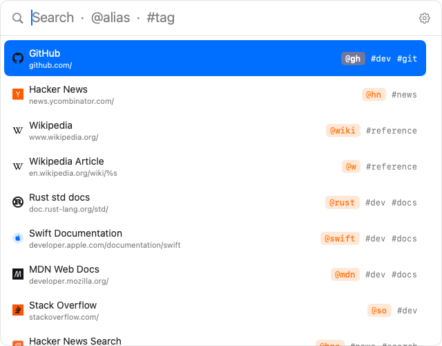
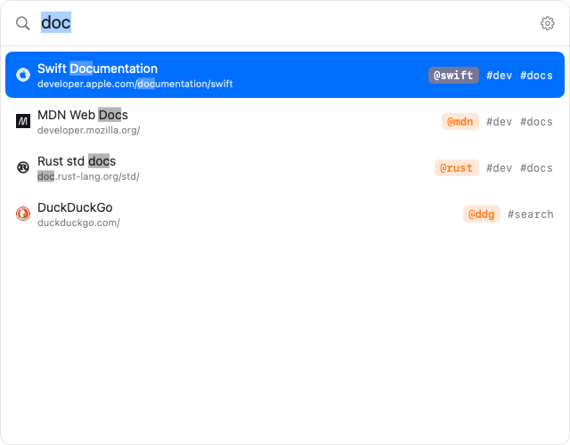
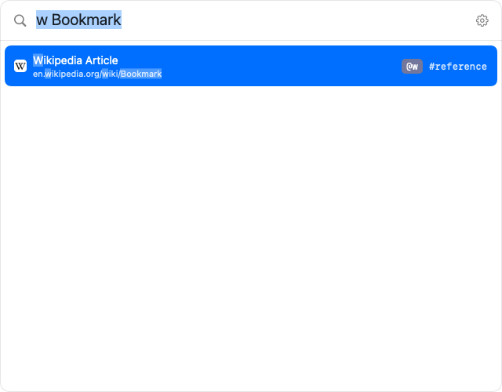
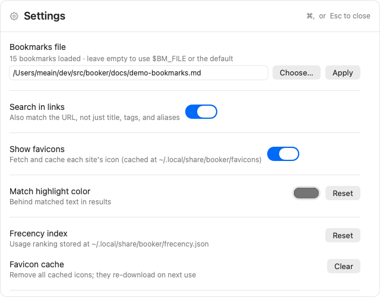

# booker

A fast, native macOS spotlight-style picker for your plaintext bookmarks.



Reads a plaintext Markdown file (`$BM_FILE`, default
`~/.local/share/bookmarks.md`) in the format:

```
- [Title](url) #tag1 #tag2 @alias1 @alias2
```

See the **[guide](docs/guide.md)** for the full file format, search syntax,
`%s` parameters, shortcuts, and file-location rules.

### Parameterized bookmarks (`%s`)

A URL may contain a `%s` placeholder. Selecting such a bookmark prompts for the
value, substitutes it into the URL, and opens the result:

```
- [Wikipedia Article](https://en.wikipedia.org/wiki/%s) #reference @w
- [Hacker News Search](https://hn.algolia.com/?q=%s) #search @hns
- [GitHub Issue](https://github.com/owner/repo/issues/%s) #dev @gi
```

Type the alias followed by the value — e.g. `w Bookmark` — and the bookmark
shows up with the URL already filled in (`en.wikipedia.org/wiki/Bookmark`), ready
to open. Or pick it with no value to get prompted.

### Beyond http links

The target is handed to macOS as-is (`NSWorkspace.open`), so any URL scheme the
system can open works, including `%s` parameters. This is handy for jumping
straight into native apps:

```
- [Obsidian Search](obsidian://search?vault=notes&query=%s) #notes @os
- [Teams channel](msteams://teams.microsoft.com/l/channel/<id>/general?groupId=<gid>&tenantId=<tid>) #work @tc
- [Slack channel](slack://channel?team=<TEAM_ID>&id=<CHANNEL_ID>) #work @sl
- [Spotify search](spotify:search:%s) #music @sp
- [Open in VS Code](vscode://file/Users/me/dev/project) #dev @code
- [Project folder](file:///Users/me/dev/project) #dev @proj
- [Email someone](mailto:someone@example.com?subject=%s) @mail
- [Run a Shortcut](shortcuts://run-shortcut?name=Morning%20routine) @morning
```

More ideas that work the same way:

```
- [Maps search](https://www.google.com/maps/search/?api=1&query=%s) #maps @maps
- [Maps directions](https://www.google.com/maps/dir/?api=1&destination=%s&travelmode=driving) #maps @dir
- [Dictionary](dict://%s) #reference @dict
- [Dev folder](file:///Users/me/dev) #folder @dev
- [Software Update settings](x-apple.systempreferences:com.apple.Software-Update-Settings.extension) #system @updates
- [Obsidian new note](obsidian://new?vault=notes&name=%s) #notes @on
- [Obsidian daily note](obsidian://daily?vault=notes) #notes @od
```

- `dir` routes from your current location to the typed destination (change
  `travelmode` to `walking` or `transit`).
- `obsidian://daily` needs Obsidian's Daily Notes plugin enabled.
- `x-apple.systempreferences:` pane IDs vary by macOS version.

#### Shortcuts for anything else

macOS has no URL for things like toggling Do Not Disturb, but a Shortcut can do
it, and `shortcuts://run-shortcut?name=<name>` runs one by name. Build the
Shortcut in the Shortcuts app (for example "Set Focus" → Do Not Disturb, on for
an hour), then link it. Use one bookmark per direction:

```
- [Focus 1h](shortcuts://run-shortcut?name=Focus%201h) #system @focus
- [Focus off](shortcuts://run-shortcut?name=Focus%20Off) #system @focusoff
```

A Shortcut can also run a shell script, which turns a bookmark into a general
launcher. That needs **Shortcuts → Settings → Advanced → Allow Running Scripts**
to be enabled.

#### Running shell commands

Any executable script can be a bookmark. Point a `file://` link at it and macOS
opens it in Terminal, which runs it:

```
- [Sync photos](file:///Users/me/bin/sync-photos) #scripts @sync
- [Start work session](file:///Users/me/bin/work-session.command) #scripts @work
```

To use it:

- Make the script executable (`chmod +x`) and give it a shebang (`#!/bin/sh`).
- Put the command, with any arguments baked in, inside the script. There is no
  `%s` support for this, so one script per command.
- Use the full path to the script, and to anything it calls if `PATH` might
  differ from your interactive shell.

A Terminal window opens each time. To have it close by itself, set **Terminal →
Settings → Profiles → Shell → When the shell exits** to **Close if the shell
exited cleanly**. This closes the window only; it doesn't quit Terminal.

Favicons and page-title fetching only apply to `http(s)` links; other schemes
show a plain row.

## Features

- **Fuzzy search** over titles, tags, and aliases. In general search the
  priority is **alias > title > tag** — an alias hit always floats above a
  title-only hit, which floats above a tag-only hit.
- **Order-independent multi-word search** — "task work" finds "Workday Tasks".
  Each word must match (in any order); a straightforward in-order match ranks
  higher.
- **Scoped search by prefix**:
  - `@foo` — search **aliases** only
  - `#foo` — search **tags** only
  - bare `@` or `#` — list everything that has any alias / tag, by frecency
- **Aliases** shown as orange chips; tags in grey.
- **Match highlighting** — the matched text in each title/URL gets a subtle
  highlight (colour configurable in settings).
- **Frecency ranking** — bookmarks you open often (and recently) float to the
  top. With an empty query the list is ordered purely by frecency.
- **`%s` parameters** — type the alias then a value (`dp 123`) to open the
  filled URL directly, or pick the bookmark to get prompted.
- **Resizable & draggable** — drag anywhere on the window to move it, drag an
  edge to resize. The size and position are remembered across launches.
- **Favicons** — each site's icon is fetched (via DuckDuckGo's icon service) and
  cached to disk (`~/.local/share/booker/favicons/`), so they show instantly on
  later launches. On by default; toggle in settings.
- **Add / edit / delete** — **⌘N** adds a bookmark (seeded from the query:
  a `http(s)` query fills the URL, anything else the title; a URL-looking query
  with no matches also shows an "Add" row). The form auto-fetches the page
  title, suggests tags from other bookmarks on the same domain, warns on
  duplicate URLs, and shows the favicon. **⌘E** edits the selected bookmark;
  **⌘⌫** deletes it (with a confirm). Edits rewrite the exact line, leaving the
  rest of the file untouched.
- **Open all via shared alias** — give several bookmarks the same alias and
  typing it shows an **"Open all N · @alias"** row that opens them together
  (alias collisions are intentional, not an error).
- **Settings** (`⌘,` or the gear icon) — set the bookmarks file location, toggle
  URL search, toggle favicons, pick the match-highlight colour, reset the
  frecency index, clear the favicon cache, and open the format docs.

## Example use-cases

- **Keyboard site launcher** — alias your daily sites and jump by muscle memory.
  ```
  - [GitHub](https://github.com/) #dev @gh
  - [Gmail](https://mail.google.com/) @mail
  ```
  Type `@gh`, hit Enter. Frecency keeps your most-used ones on top for a blank query.

- **Issue / ticket jumper** — a `%s` bookmark plus the inline value opens the exact page:
  ```
  - [Jira issue](https://acme.atlassian.net/browse/PROJ-%s) #work @jira
  - [PR by number](https://github.com/acme/app/pull/%s) #work @pr
  ```
  Type `jira 4821` → opens `…/PROJ-4821`; `pr 210` → that pull request.

- **Search shortcuts** — put the query in the URL:
  ```
  - [Wikipedia](https://en.wikipedia.org/wiki/%s) @w
  - [npm](https://www.npmjs.com/search?q=%s) #dev @npm
  ```
  `w Ada Lovelace` → the article; `npm zod` → the search.

- **App launcher** — non-http schemes open the native app directly:
  ```
  - [Notes search](obsidian://search?vault=notes&query=%s) #notes @os
  - [Team channel](slack://channel?team=T0123456&id=C0123456) #work @sl
  ```
  `os meeting` → Obsidian searching for "meeting"; `@sl` → straight into the channel.

- **"Open all" a group** — one alias on several bookmarks opens them together:
  ```
  - [Prod dashboard](https://…/prod) #dash @dash
  - [Staging dashboard](https://…/staging) #dash @dash
  - [Logs](https://…/logs) #dash @dash
  ```
  Type `@dash` → **Open all 3 · @dash** launches your whole monitoring set at once.

- **Per-context bookmark files** — point Settings (or `$BM_FILE`) at a
  project-specific file, e.g. `~/work/project/.bookmarks.md`, to swap the whole
  set when you switch contexts.

## Screenshots

Fuzzy search with matched text highlighted:



Inline `%s` parameters — type the alias and a value to open the filled URL:



Settings — bookmarks file location, toggles, highlight colour, and caches:



## Keybindings

| Key | Action |
| --- | --- |
| type | filter |
| `↓` / `Ctrl-n` | next result |
| `↑` / `Ctrl-p` | previous result |
| `Enter` | open selected in browser |
| `⌘ Enter` | copy selected URL to clipboard |
| click | open that row |
| `⌘N` | add a bookmark |
| `⌘E` | edit selected bookmark |
| `⌘⌫` | delete selected bookmark (confirm with `↩`) |
| `⌘I` | usage stats for selected bookmark |
| `⌘,` | open / close settings |
| `Esc` | close form/settings · back out of param mode · hide |
| `⌘Q` | quit |

## Build

Requires the Swift toolchain (`swift --version`).

```sh
# Dev binary
swift build
./.build/debug/booker            # launch the picker
./.build/debug/booker list       # headless: dump parsed bookmarks (debug)

# Release .app bundle (recommended for a hotkey launcher)
./build-app.sh                   # produces ./Booker.app
open ./Booker.app
```

## Wiring up a hotkey

Booker stays resident: select/escape (or clicking away) hides the window
instead of quitting, and launching it again re-shows it instantly with the
bookmarks file re-read. `⌘Q` quits for real. Point your launcher at the `.app`
bundle — use plain `open` (not `open -n`, which forces a slow fresh instance):

- **[Hammerspoon](https://www.hammerspoon.org/)**:
  ```lua
  hs.hotkey.bind({"cmd", "shift"}, "b", function()
    hs.application.launchOrFocusByBundleID("com.meain.booker")
  end)
  ```
- **[skhd](https://github.com/koekeishiya/skhd)**: `cmd + shift - b : open /path/to/booker/Booker.app`
- **[Raycast](https://www.raycast.com/) / [Alfred](https://www.alfredapp.com/)**: add a script/hotkey that runs `open .../Booker.app`.
